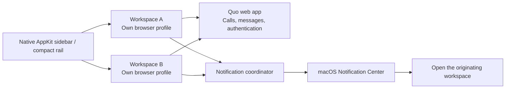

# Switchboard for Quo

**Your Quo workspaces, in one Mac app.**

I wanted to use Quo across different businesses without juggling browsers. The Mac app kept sending me back to sign-in, and switching organizations meant signing out or opening another app.

Switchboard gives each workspace its own saved browser session and keeps them running together. Quo still handles your conversations and calls. Switchboard handles the Mac experience around them.

[Download for Mac](https://github.com/ozeitis/quo-switchboard/releases) · [How it works](docs/architecture.md) · [Security](SECURITY.md) · [Build it yourself](#development)

> **Early preview.** Account isolation and notification routing are covered by desktop tests. Real Quo calling, identity-provider login, and long-term session retention still need field testing. Answer from notifications is experimental and off by default. Popover call controls require recognized current Quo controls.

## What it does

- Keep separate Quo accounts open at the same time.
- Switch with the sidebar, menu bar, or **⌘1–9**.
- Collapse the sidebar to an icon rail with **⌘⇧L**. Unread counts and call indicators stay visible.
- See which workspace sent a desktop notification. Click to open that workspace.
- Open a native activity popover from one compact menu-bar icon or **⌘⇧A**. See every workspace, observed unread counts, current calls, and recent Quo alerts. Separate workspace icons and visible counts are optional.
- See incoming, active, held, and other observable call states in the rail and menu bar. Incoming calls pulse gently; Reduce Motion stops animation.
- Choose a workspace palette, custom accent, and light/dark appearance in a native theme picker. Quo’s shared surfaces and menus inherit it.
- Answer, decline, mute, hold, resume, or end from the popover when Quo exposes an unambiguous current control. Actions select their source workspace and reject stale calls.
- Choose one microphone for every workspace. Native Settings reports availability per profile and provides a local input meter.
- Apply Quo web updates across all workspaces with one bottom-left action, also available in the compact rail. Downloads keep call controls responsive. [Update behavior](docs/updates.md).
- Keep workspaces running when the window closes.
- Preserve browser profiles across restarts and app updates.
- Choose private notification previews, launch at login, and workspace names and colors.
- Use native workspace sheets, context menus, keyboard selection, and macOS Liquid Glass controls.
- Keep Quo's navigation at a stable width. Use Mac fonts and native editing menus inside the content area.
- Adjust workspace zoom with **⌘+ / ⌘− / ⌘0**. Each workspace remembers its own size; authentication stays at actual size.
- Recover failed pages with bounded retries. Settings → Diagnostics contains connection health, notification testing, and an explicitly labeled local call simulator.

**It does not bypass Quo’s session rules.** Saved profiles avoid losing local sign-ins unnecessarily; Quo can still expire or revoke them. Switchboard does not capture passwords, replay credentials, or run its own token-refresh loop.

## How it works



Every workspace gets a persistent Chromium session and a retained `WebContentsView`. Switching changes visibility, not identity. A small sandboxed page adapter forwards notifications to Electron’s native macOS notification API. The main process assigns the account identity; the webpage cannot choose another workspace.

| Layer | Technology | Why |
| --- | --- | --- |
| Desktop runtime | Electron 44.5.1 / Chromium | Isolated profiles, background views, browser media support |
| Application code | TypeScript 7.0.2 | Strict types across account state and process boundaries |
| Workspace controls | AppKit / Objective-C++ / Node-API | Native tables, popovers, settings, sheets, SF Symbols, semantic colors and glass |
| Theme colors | Color.js 0.7.1 / OKLCH | Perceptual palettes, gamut mapping, measured contrast |
| Content shell | HTML / CSS / TypeScript | Welcome and failure states; Quo supplies its own interface |
| Mac integration | Public AppKit and Electron APIs | Native window, menus, status items, notifications and power behavior |
| Build | esbuild 0.28.2 / electron-builder 26.15.3 | Bundled app, Apple Silicon and Intel DMGs |
| Verification | Node tests / Playwright 1.63.0 | Security boundaries and actual desktop behavior |

The sidebar, toolbar, and workspace sheets, Settings window, and activity popover are native AppKit. macOS 26 and 27 supply Liquid Glass through `NSGlassEffectView` and native glass buttons; older supported systems use native vibrancy. System appearance, accent colors, and accessibility preferences drive the controls. Quo’s conversation interface remains Quo’s web app. A small presentation adapter stabilizes its sidebar and uses Mac fonts while preserving dyslexia, code, and emoji fonts. **View → Use Mac Fonts** restores Quo's typography when unchecked. The native theme picker previews each workspace independently. Apply saves; Cancel restores. See [themes and compatibility](docs/themes.md) and [architecture](docs/architecture.md).

## Install

1. Download the **arm64** DMG for Apple Silicon or **x64** DMG for Intel from [Releases](https://github.com/ozeitis/quo-switchboard/releases).
2. Open it and drag **Switchboard** to **Applications**.
3. Open Switchboard, add a workspace, and sign into Quo. Repeat for each organization.
4. Enable notifications and microphone access when macOS asks. Use **Settings → Diagnostics → Test notification** to check delivery.

If a test banner does not appear, check **System Settings → Notifications → Switchboard** and Focus. macOS can also silence banners while the display is shared or mirrored. [Apple documents that separate control](https://support.apple.com/guide/mac-help/notifications-settings-mh40583/mac); allowing it affects other apps too.

Preview builds are **ad-hoc signed, not Apple-notarized**. They do not carry a verified developer identity. macOS may block first launch; after reviewing the source and release checksums, use **System Settings → Privacy & Security → Open Anyway** if offered. Do not disable Gatekeeper globally. See [release verification and signing](docs/releases.md).

## Calls and notifications

Normal notification clicks open the correct workspace and forward the click to Quo. When the adapter recognizes one incoming-call control, it can also show an incoming-call notification. Caller details are included when Quo supplies them through a page notification; otherwise the alert identifies the workspace only.

**Answer from notifications** is an optional experiment. It invokes the current Quo answer button after checking the originating workspace and local call token again. Ambiguous or replaced controls are rejected. A detected active call blocks direct answering. Quo interface changes can break this adapter; the ordinary Quo call controls remain available.

The menu-bar popover exposes only controls the adapter currently recognizes. Each action revalidates the workspace, call token, and button before clicking. Answer is blocked while another recognized call is active; Switchboard never automatically holds or ends that call. Quo’s current public call API provides records, not a live Answer endpoint. See [the activity panel](docs/menu-bar.md).

**Settings → Audio** stores one microphone name. Each isolated profile resolves that name to its own device ID. Changes apply to the next capture; an existing call keeps its microphone. A missing or duplicate name fails visibly rather than silently using another input. See [audio behavior and verification](docs/audio.md).

Closing a window is different from quitting. Accounts stay open after the window closes; **⌘Q** disconnects them. Sleeping or offline Macs cannot guarantee incoming calls. Keep your usual phone fallback while evaluating the preview.

## Trust

- MIT licensed, maintained by [Oze](https://github.com/ozeitis).
- No Switchboard account, backend, analytics, or telemetry.
- Credentials remain in Quo’s browser sessions. No credential export or synchronization.
- Remote pages run sandboxed with Node disabled and context isolation enabled.
- Readable source, pinned dependencies, public build workflows, release checksums, and a build dependency inventory.

Quo runs its own network services and may include its own telemetry. Browser profile data is local, but not every browser storage format is encrypted. See [the security boundary](SECURITY.md).

## Development

Use macOS, Node.js 24 LTS or newer, and Xcode 27 or newer with the macOS SDK selected through `xcode-select`. The build compiles a universal Apple Silicon/Intel Node-API module from `native/shell.mm`.

```sh
npm ci
npm run check
npm run test:desktop
npm start
```

Create installable builds:

```sh
npm run dist -- --arm64 --x64
```

Outputs are in `release/`. Icons are checked in; regenerate them with `swift scripts/icons.swift assets` followed by `iconutil -c icns assets/AppIcon.iconset -o assets/icon.icns`.

Development uses a separate `Switchboard Development` profile directory. Packaged releases keep their profiles under `Switchboard`.

## Known boundaries

| Area | Current behavior |
| --- | --- |
| Login renewal | Quo owns it. No promise of permanent sign-in. |
| Google / SSO | Embedded login can be refused; browser login does not automatically transfer into the app. Email login is the first path to test. |
| Notifications | Page-created notifications are forwarded. Service-worker notifications are not rewritten by the adapter. |
| Themes | Verified against Quo’s current color contract. Unknown contracts restore original colors; provider changes need review. |
| Microphone | Shared choice applies to future captures. Physical devices, Bluetooth, permissions, and real calls still need field testing. |
| Call detection | Based on visible, English-language accessible controls. Quo UI changes or other locales may require adapter updates. |
| Connection status | “Workspace loaded” means the page loaded, not that Quo has confirmed its calling transport. |
| Idle recovery | Only failed pages retry, at most five attempts per fifteen minutes. Healthy or active calls are never reloaded merely because time passed. |
| Health report | Local page-response samples every ten seconds. It does not establish provider-side message or call delivery. |
| Memory | All added workspaces remain loaded; inactive ones are not hibernated. |
| Updates | One sidebar action applies waiting Quo web updates across signed-in profiles. New Switchboard installers still require replacing the app; profiles stay outside its bundle. |
| Quo API / webhooks | Not required or connected in this release. Public APIs do not replace Quo’s live call engine. |

[Field-test checklist](docs/testing.md) · [Contributing](CONTRIBUTING.md)

[Menu-bar design and count semantics](docs/menu-bar.md)

Switchboard is independent software. It is not affiliated with or endorsed by Quo. Quo’s website, service, and trademarks belong to their respective owners.
