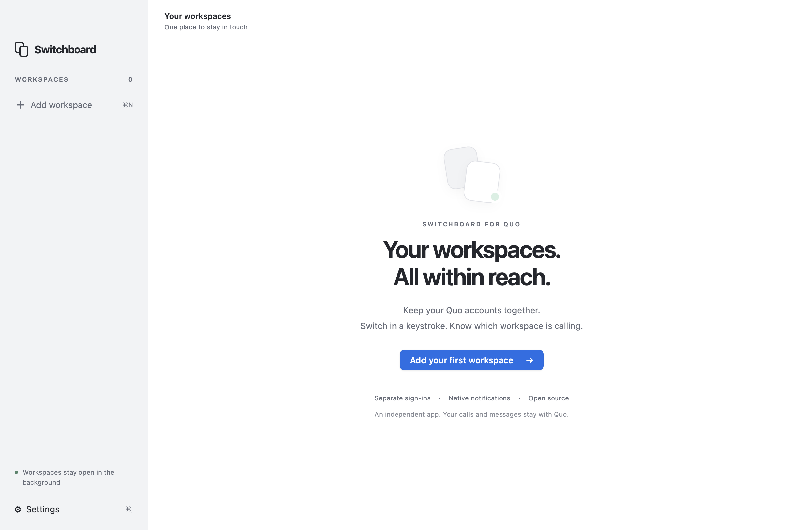
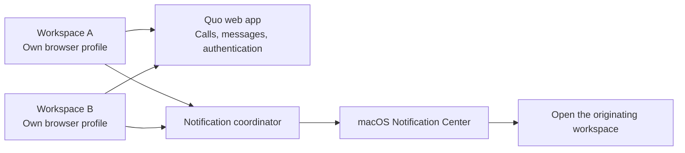

# Switchboard for Quo

**Your Quo workspaces, in one Mac app.**

I wanted to use Quo across different businesses without juggling browsers. The Mac app kept sending me back to sign-in, and switching organizations meant signing out or opening another app.

Switchboard gives each workspace its own saved browser session and keeps them running together. Quo still handles your conversations and calls. Switchboard handles the Mac experience around them.

[Download for Mac](https://github.com/ozeitis/quo-switchboard/releases) · [How it works](docs/architecture.md) · [Security](SECURITY.md) · [Build it yourself](#development)



> **Early preview.** Account isolation and notification routing are covered by desktop tests. Real Quo calling, identity-provider login, and long-term session retention still need field testing. Direct answering is experimental and off by default.

## What it does

- Keep separate Quo accounts open at the same time.
- Switch with the sidebar, menu bar, or **⌘1–9**.
- See which workspace sent a desktop notification. Click to open that workspace.
- Keep workspaces running when the window closes.
- Preserve browser profiles across restarts and app updates.
- Choose private notification previews, launch at login, and workspace names and colors.

**It does not bypass Quo’s session rules.** Saved profiles avoid losing local sign-ins unnecessarily; Quo can still expire or revoke them. Switchboard does not capture passwords, replay credentials, or run its own token-refresh loop.

## How it works



Every workspace gets a persistent Chromium session and a retained `WebContentsView`. Switching changes visibility, not identity. A small sandboxed page adapter forwards notifications to Electron’s native macOS notification API. The main process assigns the account identity; the webpage cannot choose another workspace.

| Layer | Technology | Why |
| --- | --- | --- |
| Desktop runtime | Electron 44.5.1 / Chromium | Isolated profiles, background views, browser media support |
| Application code | TypeScript 7.0.2 | Strict types across account state and process boundaries |
| Shell | Semantic HTML / CSS / TypeScript | Small UI, no runtime framework dependencies |
| Mac integration | Electron’s native window, menu, tray, notification and power APIs | System behavior where it matters |
| Build | esbuild 0.28.2 / electron-builder 26.15.3 | Bundled app, Apple Silicon and Intel DMGs |
| Verification | Node tests / Playwright 1.63.0 | Security boundaries and actual desktop behavior |

The sidebar is web-rendered. Window controls, menus, and notifications use native macOS facilities. This is a wrapper around Quo, not a rewritten phone system. See [architecture and extension points](docs/architecture.md).

## Install

1. Download the **arm64** DMG for Apple Silicon or **x64** DMG for Intel from [Releases](https://github.com/ozeitis/quo-switchboard/releases).
2. Open it and drag **Switchboard** to **Applications**.
3. Open Switchboard, add a workspace, and sign into Quo. Repeat for each organization.
4. Enable notifications and microphone access when macOS asks. Use **Settings → Test notification** to check delivery.

Preview builds are **ad-hoc signed, not Apple-notarized**. They do not carry a verified developer identity. macOS may block first launch; after reviewing the source and release checksums, use **System Settings → Privacy & Security → Open Anyway** if offered. Do not disable Gatekeeper globally. See [release verification and signing](docs/releases.md).

## Calls and notifications

Normal notification clicks open the correct workspace and forward the click to Quo. When the adapter recognizes one incoming-call control, it can also show an incoming-call notification. Caller details are included when Quo supplies them through a page notification; otherwise the alert identifies the workspace only.

**Answer from notifications** is an optional experiment. It invokes the current Quo answer button after checking the originating workspace and local call token again. Ambiguous or replaced controls are rejected. A detected active call blocks direct answering. Quo interface changes can break this adapter; the ordinary Quo call controls remain available.

Closing a window is different from quitting. Accounts stay open after the window closes; **⌘Q** disconnects them. Sleeping or offline Macs cannot guarantee incoming calls. Keep your usual phone fallback while evaluating the preview.

## Trust

- MIT licensed, maintained by [Oze](https://github.com/ozeitis).
- No Switchboard account, backend, analytics, or telemetry.
- Credentials remain in Quo’s browser sessions. No credential export or synchronization.
- Remote pages run sandboxed with Node disabled and context isolation enabled.
- Readable source, pinned dependencies, public build workflows, release checksums, and a build dependency inventory.

Quo runs its own network services and may include its own telemetry. Browser profile data is local, but not every browser storage format is encrypted. See [the security boundary](SECURITY.md).

## Development

Use macOS and Node.js 24 LTS or newer.

```sh
npm ci
npm run check
npm run test:desktop
npm start
```

Create installable builds:

```sh
npm run dist -- --arm64 --x64
```

Outputs are in `release/`. Icons are checked in; regenerate them with `swift scripts/icons.swift assets` followed by `iconutil -c icns assets/AppIcon.iconset -o assets/icon.icns`.

## Known boundaries

| Area | Current behavior |
| --- | --- |
| Login renewal | Quo owns it. No promise of permanent sign-in. |
| Google / SSO | Embedded login can be refused; browser login does not automatically transfer into the app. Email login is the first path to test. |
| Notifications | Page-created notifications are forwarded. Service-worker notifications are not rewritten by the adapter. |
| Call detection | Based on visible, English-language accessible controls. Quo UI changes or other locales may require adapter updates. |
| Connection status | “Workspace loaded” means the page loaded, not that Quo has confirmed its calling transport. |
| Memory | All added workspaces remain loaded; inactive ones are not hibernated. |
| Updates | Download and replace the app manually. Profiles stay outside the app bundle. |
| Quo API / webhooks | Not required or connected in this release. Public APIs do not replace Quo’s live call engine. |

[Field-test checklist](docs/testing.md) · [Contributing](CONTRIBUTING.md)

Switchboard is independent software. It is not affiliated with or endorsed by Quo. Quo’s website, service, and trademarks belong to their respective owners.
