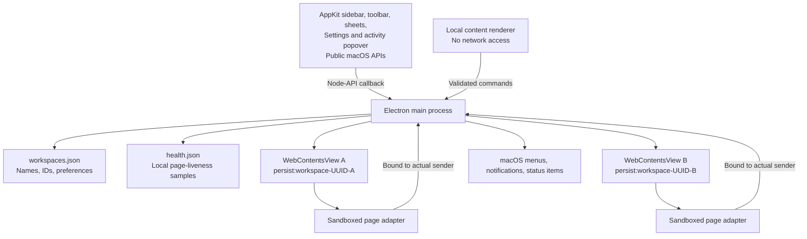

# Architecture

Switchboard owns the desktop container. Quo owns authentication, communications, and the web interface. The boundary is intentional: replacing a working phone system would add risk without solving the account-switching problem.

## Processes and state



`Accounts` retains one view per workspace. Switching changes selection and visibility. Each UUID selects an independent Chromium session, including cookies and website storage. Renaming, recoloring, and reordering never replace that UUID. A duplicate UUID in the settings file is rejected rather than silently sharing a login.

The native bridge runs only in the main process. It owns AppKit views and sends small command objects through a Node-API thread-safe callback. It has no access to account cookies or page contents. Commands enter the same validated queue as local renderer commands. Shared web updates start in order, then run outside that queue so downloads cannot delay call controls. Workspace creation uses a native sheet: nothing is created until a valid name is submitted. Only one sheet can be open at a time. Native sheets do not hide or recreate the Quo view.

The sidebar collapses from 208 to 56 points. The same retained browser views gain the extra space; workspace initials, unread badges, call indicators, context menus, and notifications remain available. The preference survives relaunch. A brief native fade respects Reduce Motion. Secondary actions live in the options and system menus rather than a permanent row of sidebar buttons. The 52-point toolbar spans the window, with a single workspace title and small SF Symbol controls that show their native border on hover. Connection and call status appear when relevant. Shared geometry in `src/shared/layout.ts` keeps AppKit, Chromium, and the local renderer aligned.

One `NSGlassEffectView` joins the sidebar and toolbar. A public QuartzCore shape mask cuts out the page area, retaining a 16-point curve at its top-left corner. The decorative material sits above Chromium and returns no hit-test target, so page controls remain reachable. Retained Quo views extend to the window's right and bottom edges; the native window owns the outer corners. There is no extra inset frame.

A sandboxed presentation adapter keeps Quo's `#sideMenu` at 248 CSS pixels instead of switching to 192 below its 1,400-pixel breakpoint. It discovers Inter/Roobert typography tokens from the surrounding theme and replaces them with the Mac system stack inside the sidebar and main content. Dyslexia, monospace, handwriting, and emoji tokens remain untouched. It does not replace controls, click handlers, routing, or call logic. Missing sidebar/token markers leave the corresponding presentation unchanged; Quo markup changes still require compatibility testing. The font preference can be disabled under View and survives restart.

Native text menus provide spelling suggestions and editing commands. Each command captures its originating `WebContents`; the popup also receives Chromium's originating frame. Workspace zoom uses Electron 44's isolated zoom mode and a validated factor saved alongside the existing UUID. Changing zoom never replaces a profile. Authentication uses actual size, and the selected scale returns when the workspace is ready. Native controls around the webpage keep their normal size.

Native table rows draw an inset selection inside the actual viewport; extra AppKit table gutters cannot clip its corners. Native toolbar controls and semantic system colors complete the macOS appearance. No private glass variants, method swizzling, or JavaScript imitation of glass is used. The native controls are included in the window's accessibility tree alongside Chromium. The HTML workspace UI remains available only as an explicit development/test fallback; packaged macOS builds require the native module.

Settings are validated on read and write, saved through a temporary file and rename, and created with owner-only file permissions. A malformed settings file stops startup without replacing it. Browser profiles live outside the application bundle under `~/Library/Application Support/Switchboard`.

`MenuBar` supplies a compact AppKit status item and a native `NSPopover`. One item is the default; separate workspace items and visible counts are optional. Stable autosave identities preserve placement. macOS 27 uses `NSStatusItemExpandedInterfaceDelegate` for expanded-interface focus and lifecycle; older supported systems use a normal status-button action. The panel shows every workspace, observed unread counts, current call controls, and four recent forwarded Quo alerts. Alert history is bounded to twenty items, held only in memory, and redacted by the private-preview setting. A single 650 ms timer animates only ringing symbols and stops for Reduce Motion, hidden items, or disabled animation. Ring frames do not rebuild the panel.

Settings is a separate nonmodal AppKit window with General, Audio, and Diagnostics sections. Preferences apply immediately through validated single-field commands. Audio selects a shared microphone label; each sandboxed profile independently resolves its origin-specific media device ID. Existing streams remain intact. Local refresh and input tests release their tracks and are blocked during recognized calls or captures. See [audio architecture](audio.md).

`Calls` revalidates source workspace, current call token, and available action in the main process. The preload repeats validation against the live DOM before clicking exactly one recognized control and acknowledges the request. Stale, replaced, or ambiguous controls fail closed. Answering selects the originating workspace and is blocked if another recognized call is active. The diagnostics simulator uses separate local state, expires after a minute, and never manipulates Quo call controls or unread counts.

The unread adapter reads Quo's semantic navigation badge labels, with a title fallback. It reports unavailable counts explicitly and preserves hovered-row counts while Quo displays More in place of a badge. It never sums the title with sidebar badges or counts the selected conversation list again. Unread changes update the rail, Dock, and status item; they do not replay old desktop alerts. See [count semantics and menu-bar design](menu-bar.md).

Email login navigates from `my.quo.com` through Quo's production Auth0 domain, `signin.openphone.com`, and back to Quo in the same view. Keeping the browsing context intact preserves Quo's authentication transaction in session storage. The authentication origin is allowed to navigate but receives no page adapter or privileged bridge. Ordinary external links open in the browser without resetting the current workspace's call state.

## Workspace appearance

A native AppKit sheet owns the palette cards, appearance segments, and standard macOS color well. Live previews live in memory; Apply validates and atomically saves only the theme alongside the existing workspace UUID. Cancellation, Escape, or notification-driven account switching restores the saved theme. Window appearance and glass tint follow the active workspace. Other retained views receive their own palettes.

Color.js generates OKLCH palettes, maps them to sRGB, and measures contrast after hex serialization. Text and solid-button accents are distinct roles. Native controls keep macOS semantic colors; call and warning colors retain their meanings. The sandboxed presentation adapter discovers Quo’s 88-token contract from same-origin CSSOM, validates its complete fingerprint, and overrides verified providers including body portals. It also handles BlockNote/Mantine editor tokens, Plyr audio controls, and a small set of audited exceptions. Unknown contracts remove color overrides. Authentication remains untouched. See [coverage and maintenance](themes.md).

## Notification flow

```mermaid
sequenceDiagram
  participant Q as Quo workspace B
  participant P as Sandboxed adapter
  participant M as Main process
  participant N as macOS
  participant U as User
  Q->>P: new Notification(title, options)
  P->>M: Bounded notification payload
  M->>M: Derive workspace from sender; validate and rate-limit
  M->>N: Notification labeled with workspace B
  U->>N: Open / Answer
  N->>M: Action on retained notification
  M->>Q: Show B; forward original click
  opt Experimental Answer
    M->>M: Match current ring token; reject known active calls
    M->>P: Explicit user action with ring token
    P->>P: Revalidate exact, unique visible answer control
    P->>Q: Invoke existing answer control
  end
```

Page notifications retain their original click callback. The adapter does not read the user’s conversation history. It forwards title/body data already supplied by Quo to its Notification constructor. It emulates the subset of the browser Notification interface used here; it is not a full browser Notification implementation. Service-worker notifications bypass this page adapter.

Incoming-call observation uses accessible button labels, never screen coordinates. A ring token identifies the lifetime of one exact DOM control. Removal or replacement invalidates the token. Two candidate controls revoke direct answering. English labels currently supported: “Answer call”, “Accept call”, or “Answer” / “Accept” inside a dialog whose accessible label or text identifies “Incoming call”. No private Quo API is called.

This cannot establish a durable server call ID or prove transport health. A webpage can change faster than the adapter. Answer from notifications therefore defaults off and is labeled experimental. Popover and floating-panel call controls are available only while a current unambiguous control is recognized; they share the same UI-observation limitation. Call-state inference also means cross-account busy detection is conservative only for recognized controls; it is not a replacement for provider-level call coordination.

`CallPanel` publishes source-bound incoming cards to a nonactivating AppKit `NSPanel` and a native strip inside the main window. The strip reserves space above Quo, shows calls to every workspace, and scrolls after three rows. Desktop-alert preferences hide the floating panel while leaving in-app controls available. Screen lock hides both; preview privacy is applied before either receives caller text. Floating dismissal is local to its control token. Both surfaces and notification actions use the same acknowledged `Calls` coordinator. See [call design](calls.md).

## Lifecycle

- `Cmd+1–9` selects a retained view; profiles and web transports remain intact.
- A hidden window keeps views alive. Closing does not quit.
- Background timer throttling is disabled for Quo views. This costs resources; there is no promise of constant CPU or RAM use.
- On wake, every app-origin page receives a liveness probe. Quo handles its own transport recovery. Only failed pages retry automatically, with delays of 2, 5, 15, 30, and 60 seconds and a five-attempt budget per fifteen minutes. A responsive load cancels a pending retry. A hung but still-running page is recorded, not reloaded blindly during a possible call.
- During a detected active call, an app-suspension assertion runs until the call ends. It does not promise lid-closed operation or override deliberate system sleep.
- Reload, remove, and quit ask before interrupting a detected call or deleting a local profile.
- Quitting waits for cookie-store flushes before closing account views. Storage errors are recorded locally.
- Window size and position are retained and clamped to available displays on launch.

## Health evidence

The isolated preload sends a heartbeat every ten seconds. The main process records sample counts, last response, largest observed awake gap, and bounded lifecycle events. A thirty-second checkpoint writes `health.json` with owner-only permissions. It contains workspace UUIDs and timestamps, not names, credentials, URLs, notification contents, or messages. It is never uploaded. This run's report is replaced on the next launch; copy it before restarting when preserving soak-test evidence.

Sleep and wake are recorded separately. Expected sleep time is excluded from the awake-gap measurement. A missing page response may also mean navigation or reauthentication; it is not proof of a broken Quo connection. No liveness probe can certify the provider's WebSocket, media path, refresh token, or message delivery. That requires real-account acceptance tests after idle, network recovery, and sleep.

## Why this stack

Electron provides a shipped Chromium runtime, isolated persistent sessions, maintained embedding APIs, and direct control over the lifecycle of hidden views. AppKit supplies the native controls around that working browser engine. This preserves Quo's tested Chromium login/media behavior while giving workspace management native Mac interaction and accessibility.

Application logic is strict TypeScript. The small native bridge is Objective-C++ with ARC and Node-API. Clang builds a universal native module; esbuild produces the main, two preload, and content-renderer bundles. Preloads are self-contained because sandboxed Electron preloads cannot load arbitrary Node modules. `node-api-headers` is a pinned build dependency. There are no external production npm dependencies in application code.

## Extensions worth adding

1. **Verified Quo call integration.** Prefer a documented partner interface if Quo offers one. Replace the DOM adapter without changing account ownership or native notification routing.
2. **Optional webhook relay.** Server verifies signatures and forwards a minimal event envelope to the app. Deduplicate by event identity, compare resource timestamps, map organization IDs explicitly, and reject stale ringing. Workspace-level ringing does not automatically mean this user should answer.
3. **Signed updates.** Introduce Developer ID signing, notarization, and authenticated updates before enabling automatic installation.
4. **Richer workspace management.** Extend the AppKit shell behind the existing command interface without expanding remote-page privileges.

No relay, API key storage, server, or paid subscription is part of this release.

## Source map

| File | Responsibility |
| --- | --- |
| `src/main/index.ts` | App lifecycle, menus, IPC authorization, command routing |
| `src/main/accounts.ts` | Profile isolation, navigation, permissions, views |
| `src/main/text-menu.ts` | Native text menus bound to their originating browser view |
| `src/main/call-panel.ts` | Source-bound floating incoming calls and privacy |
| `native/call-panel.mm` | Nonactivating AppKit panel and native call buttons |
| `src/main/menu-bar.ts` | Native activity models, status-item preferences, ringing animation |
| `src/preload/appearance.ts` | Scoped Quo navigation and typography adaptation |
| `src/preload/unread.ts` | Semantic unread badge observation and unavailable-state reporting |
| `src/main/notifications.ts` | Native notifications, session-only activity, account-bound actions |
| `src/main/calls.ts` | Guarded current-call commands and acknowledgements |
| `src/main/web-updates.ts` | Shared update checks, call guards, source-bound results, reload confirmation |
| `src/preload/web-updates.ts` | Exact Quo service-worker observation and guarded activation |
| `src/preload/audio.ts` | Profile-local microphone resolution and local input tests |
| `src/shared/audio.ts` | Validated shared microphone preferences and state |
| `src/main/store.ts` | Validated settings persistence |
| `src/main/policy.ts` | URL policy, text normalization, rate limits |
| `src/main/native-shell.ts` | Main-process-only native bridge |
| `native/shell.mm` | AppKit shell, sheets, menus, accessibility |
| `native/activity.mm` | Native status items and activity popover |
| `native/settings.mm` | Native General, Audio, and Diagnostics settings |
| `src/shared/layout.ts` | Shared native/browser/renderer geometry |
| `src/main/health.ts` | Local liveness evidence and bounded recovery policy |
| `src/main/window-state.ts` | Window geometry persistence |
| `src/preload/account.ts` | Narrow page notification and call adapter |
| `src/preload/call-controls.ts` | Conservative call-control recognition |
| `src/preload/shell.ts` | Local UI bridge |
| `src/renderer/` | Welcome/failure states and development HTML fallback |

## References

- [Apple NSGlassEffectView](https://developer.apple.com/documentation/appkit/nsglasseffectview)
- [Apple's macOS 27 design updates](https://developer.apple.com/videos/play/wwdc2026/289/)
- [Node-API thread-safe callbacks](https://nodejs.org/api/n-api.html#asynchronous-thread-safe-function-calls)
- [Electron security](https://www.electronjs.org/docs/latest/tutorial/security)
- [Persistent sessions](https://www.electronjs.org/docs/latest/api/session)
- [Isolated workspace zoom](https://www.electronjs.org/docs/latest/api/web-contents#contentssetzoommodemode)
- [Frame-aware native menus](https://www.electronjs.org/docs/latest/api/menu#menupopupoptions)
- [Sandboxed presentation styles](https://www.electronjs.org/docs/latest/api/web-frame#webframeinsertcsscss-options)
- [Native notifications](https://www.electronjs.org/docs/latest/api/notification)
- [Quo session policy](https://support.quo.com/core-concepts/account/account-security)
- [Quo API capabilities](https://www.quo.com/docs/2026-03-30/introduction)
- [Quo webhook delivery semantics](https://www.quo.com/docs/2026-03-30/webhooks-overview)
- [Google embedded-browser policy](https://developers.google.com/identity/protocols/oauth2/policies)
