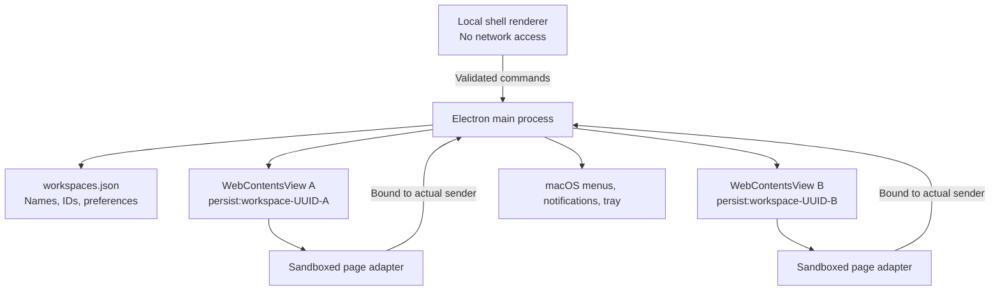

# Architecture

Switchboard owns the desktop container. Quo owns authentication, communications, and the web interface. The boundary is intentional: replacing a working phone system would add risk without solving the account-switching problem.

## Processes and state



`Accounts` retains one view per workspace. The sidebar is the only part of account switching that changes. Each UUID selects an independent Chromium session, including cookies and website storage. A duplicate UUID in the settings file is rejected rather than silently sharing a login.

Settings are validated on read and write, saved through a temporary file and rename, and created with owner-only file permissions. A malformed settings file stops startup without replacing it. Browser profiles live outside the application bundle under `~/Library/Application Support/Switchboard`.

## Notification flow

```mermaid
sequenceDiagram
  participant Q as Quo workspace B
  participant P as Sandboxed adapter
  participant M as Main process
  participant N as macOS
  participant U as User
  Q->>P: new Notification(title, options)
  P->>M: Bounded notification payload
  M->>M: Derive workspace from sender; validate and rate-limit
  M->>N: Notification labeled with workspace B
  U->>N: Open / Answer
  N->>M: Action on retained notification
  M->>Q: Show B; forward original click
  opt Experimental Answer
    M->>M: Match current ring token; reject known active calls
    M->>P: Explicit user action with ring token
    P->>P: Revalidate exact, unique visible answer control
    P->>Q: Invoke existing answer control
  end
```

Page notifications retain their original click callback. The adapter does not read the user’s conversation history. It forwards title/body data already supplied by Quo to its Notification constructor. It emulates the subset of the browser Notification interface used here; it is not a full browser Notification implementation. Service-worker notifications bypass this page adapter.

Incoming-call observation uses accessible button labels, never screen coordinates. A ring token identifies the lifetime of one exact DOM control. Removal or replacement invalidates the token. Two candidate controls revoke direct answering. English labels currently supported: “Answer call”, “Accept call”, or “Answer” / “Accept” inside a dialog explicitly containing “Incoming call”. No private Quo API is called.

This cannot establish a durable server call ID or prove transport health. A webpage can change faster than the adapter. Direct answering therefore defaults off and is labeled experimental. Call-state inference also means cross-account busy detection is conservative only for recognized controls; it is not a replacement for provider-level call coordination.

## Lifecycle

- `Cmd+1–9` selects a retained view; profiles and web transports remain intact.
- A hidden window keeps views alive. Closing does not quit.
- Background timer throttling is disabled for Quo views. This costs resources; there is no promise of constant CPU or RAM use.
- On wake, Quo handles its own transport recovery. Only failed pages are reloaded automatically.
- During a detected active call, an app-suspension assertion runs until the call ends. It does not promise lid-closed operation or override deliberate system sleep.
- Reload, remove, and quit ask before interrupting a detected call or deleting a local profile.
- Quitting flushes browser storage and closes all account views.

## Why this stack

Electron provides a shipped Chromium runtime, isolated persistent sessions, maintained embedding APIs, and direct control over the lifecycle of hidden views. SwiftUI/WebKit would make the surrounding controls native, but would require a separate compatibility investigation for Quo login, media, and background behavior. The renderer is small enough to use the platform DOM directly; a component framework would not currently reduce complexity.

All source is TypeScript. esbuild produces a main bundle, two preload bundles, and a local UI bundle. The preload bundles are self-contained because sandboxed Electron preloads cannot load arbitrary Node modules. There are no external production npm dependencies in application code.

## Extensions worth adding

1. **Verified Quo call integration.** Prefer a documented partner interface if Quo offers one. Replace the DOM adapter without changing account ownership or native notification routing.
2. **Optional webhook relay.** Server verifies signatures and forwards a minimal event envelope to the app. Deduplicate by event identity, compare resource timestamps, map organization IDs explicitly, and reject stale ringing. Workspace-level ringing does not automatically mean this user should answer.
3. **Signed updates.** Introduce Developer ID signing, notarization, and authenticated updates before enabling automatic installation.
4. **More native controls.** Native helper modules can be introduced behind the main-process interface. They must not expand remote-page privileges.

No relay, API key storage, server, or paid subscription is part of this release.

## Source map

| File | Responsibility |
| --- | --- |
| `src/main/index.ts` | App lifecycle, menus, IPC authorization, command routing |
| `src/main/accounts.ts` | Profile isolation, navigation, permissions, views |
| `src/main/notifications.ts` | Native notifications and account-bound actions |
| `src/main/store.ts` | Validated settings persistence |
| `src/main/policy.ts` | URL policy, text normalization, rate limits |
| `src/preload/account.ts` | Narrow page notification and call adapter |
| `src/preload/call-controls.ts` | Conservative call-control recognition |
| `src/preload/shell.ts` | Local UI bridge |
| `src/renderer/` | Workspace navigation and settings |

## References

- [Electron security](https://www.electronjs.org/docs/latest/tutorial/security)
- [Persistent sessions](https://www.electronjs.org/docs/latest/api/session)
- [Native notifications](https://www.electronjs.org/docs/latest/api/notification)
- [Quo session policy](https://support.quo.com/core-concepts/account/account-security)
- [Quo API capabilities](https://www.quo.com/docs/2026-03-30/introduction)
- [Quo webhook delivery semantics](https://www.quo.com/docs/2026-03-30/webhooks-overview)
- [Google embedded-browser policy](https://developers.google.com/identity/protocols/oauth2/policies)
