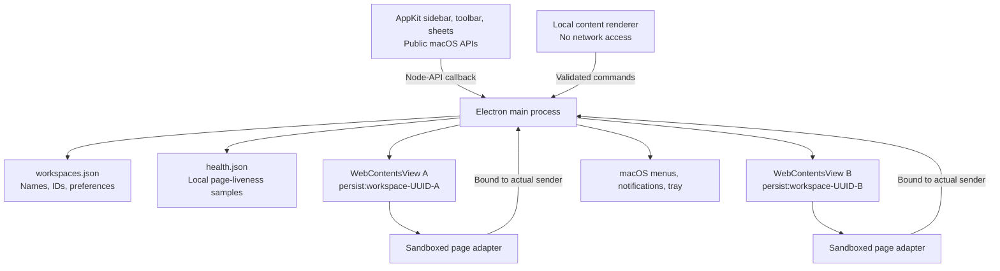

# Architecture

Switchboard owns the desktop container. Quo owns authentication, communications, and the web interface. The boundary is intentional: replacing a working phone system would add risk without solving the account-switching problem.

## Processes and state



`Accounts` retains one view per workspace. Switching changes selection and visibility. Each UUID selects an independent Chromium session, including cookies and website storage. Renaming, recoloring, and reordering never replace that UUID. A duplicate UUID in the settings file is rejected rather than silently sharing a login.

The native bridge runs only in the main process. It owns AppKit views and sends small command objects through a Node-API thread-safe callback. It has no access to account cookies or page contents. Commands enter the same validated, serialized queue as local renderer commands. Workspace creation uses a native sheet: nothing is created until a valid name is submitted. Only one sheet can be open at a time. Native sheets do not hide or recreate the Quo view.

The sidebar collapses from 208 to 56 points. The same retained browser views gain the extra space; workspace initials, unread badges, call indicators, context menus, and notifications remain available. The preference survives relaunch. A brief native fade respects Reduce Motion. Secondary actions live in the options and system menus rather than a permanent row of sidebar buttons. The 52-point toolbar spans the window, with a single workspace title and small SF Symbol controls that show their native border on hover. Connection and call status appear when relevant. Shared geometry in `src/shared/layout.ts` keeps AppKit, Chromium, and the local renderer aligned.

One `NSGlassEffectView` spans the window beneath Chromium, so the sidebar and toolbar share a continuous material without intersecting glass edges. The retained Quo views use Electron's public `View.setBorderRadius` with a 16-point radius and an 8-point right/bottom gutter. Native table rows draw an inset selection inside the actual viewport; extra AppKit table gutters cannot clip its corners. Native toolbar controls and semantic system colors complete the macOS appearance. No private glass variants, method swizzling, or JavaScript imitation of glass is used. The native controls are included in the window's accessibility tree alongside Chromium. The HTML workspace UI remains available only as an explicit development/test fallback; packaged macOS builds require the native module.

Settings are validated on read and write, saved through a temporary file and rename, and created with owner-only file permissions. A malformed settings file stops startup without replacing it. Browser profiles live outside the application bundle under `~/Library/Application Support/Switchboard`.

Email login navigates from `my.quo.com` through Quo's production Auth0 domain, `signin.openphone.com`, and back to Quo in the same view. Keeping the browsing context intact preserves Quo's authentication transaction in session storage. The authentication origin is allowed to navigate but receives no page adapter or privileged bridge. Ordinary external links open in the browser without resetting the current workspace's call state.

## Notification flow

```mermaid
sequenceDiagram
  participant Q as Quo workspace B
  participant P as Sandboxed adapter
  participant M as Main process
  participant N as macOS
  participant U as User
  Q->>P: new Notification(title, options)
  P->>M: Bounded notification payload
  M->>M: Derive workspace from sender; validate and rate-limit
  M->>N: Notification labeled with workspace B
  U->>N: Open / Answer
  N->>M: Action on retained notification
  M->>Q: Show B; forward original click
  opt Experimental Answer
    M->>M: Match current ring token; reject known active calls
    M->>P: Explicit user action with ring token
    P->>P: Revalidate exact, unique visible answer control
    P->>Q: Invoke existing answer control
  end
```

Page notifications retain their original click callback. The adapter does not read the user’s conversation history. It forwards title/body data already supplied by Quo to its Notification constructor. It emulates the subset of the browser Notification interface used here; it is not a full browser Notification implementation. Service-worker notifications bypass this page adapter.

Incoming-call observation uses accessible button labels, never screen coordinates. A ring token identifies the lifetime of one exact DOM control. Removal or replacement invalidates the token. Two candidate controls revoke direct answering. English labels currently supported: “Answer call”, “Accept call”, or “Answer” / “Accept” inside a dialog explicitly containing “Incoming call”. No private Quo API is called.

This cannot establish a durable server call ID or prove transport health. A webpage can change faster than the adapter. Direct answering therefore defaults off and is labeled experimental. Call-state inference also means cross-account busy detection is conservative only for recognized controls; it is not a replacement for provider-level call coordination.

## Lifecycle

- `Cmd+1–9` selects a retained view; profiles and web transports remain intact.
- A hidden window keeps views alive. Closing does not quit.
- Background timer throttling is disabled for Quo views. This costs resources; there is no promise of constant CPU or RAM use.
- On wake, every app-origin page receives a liveness probe. Quo handles its own transport recovery. Only failed pages retry automatically, with delays of 2, 5, 15, 30, and 60 seconds and a five-attempt budget per fifteen minutes. A responsive load cancels a pending retry. A hung but still-running page is recorded, not reloaded blindly during a possible call.
- During a detected active call, an app-suspension assertion runs until the call ends. It does not promise lid-closed operation or override deliberate system sleep.
- Reload, remove, and quit ask before interrupting a detected call or deleting a local profile.
- Quitting waits for cookie-store flushes before closing account views. Storage errors are recorded locally.
- Window size and position are retained and clamped to available displays on launch.

## Health evidence

The isolated preload sends a heartbeat every ten seconds. The main process records sample counts, last response, largest observed awake gap, and bounded lifecycle events. A thirty-second checkpoint writes `health.json` with owner-only permissions. It contains workspace UUIDs and timestamps, not names, credentials, URLs, notification contents, or messages. It is never uploaded. This run's report is replaced on the next launch; copy it before restarting when preserving soak-test evidence.

Sleep and wake are recorded separately. Expected sleep time is excluded from the awake-gap measurement. A missing page response may also mean navigation or reauthentication; it is not proof of a broken Quo connection. No liveness probe can certify the provider's WebSocket, media path, refresh token, or message delivery. That requires real-account acceptance tests after idle, network recovery, and sleep.

## Why this stack

Electron provides a shipped Chromium runtime, isolated persistent sessions, maintained embedding APIs, and direct control over the lifecycle of hidden views. AppKit supplies the native controls around that working browser engine. This preserves Quo's tested Chromium login/media behavior while giving workspace management native Mac interaction and accessibility.

Application logic is strict TypeScript. The small native bridge is Objective-C++ with ARC and Node-API. Clang builds a universal native module; esbuild produces the main, two preload, and content-renderer bundles. Preloads are self-contained because sandboxed Electron preloads cannot load arbitrary Node modules. `node-api-headers` is a pinned build dependency. There are no external production npm dependencies in application code.

## Extensions worth adding

1. **Verified Quo call integration.** Prefer a documented partner interface if Quo offers one. Replace the DOM adapter without changing account ownership or native notification routing.
2. **Optional webhook relay.** Server verifies signatures and forwards a minimal event envelope to the app. Deduplicate by event identity, compare resource timestamps, map organization IDs explicitly, and reject stale ringing. Workspace-level ringing does not automatically mean this user should answer.
3. **Signed updates.** Introduce Developer ID signing, notarization, and authenticated updates before enabling automatic installation.
4. **Richer workspace management.** Extend the AppKit shell behind the existing command interface without expanding remote-page privileges.

No relay, API key storage, server, or paid subscription is part of this release.

## Source map

| File | Responsibility |
| --- | --- |
| `src/main/index.ts` | App lifecycle, menus, IPC authorization, command routing |
| `src/main/accounts.ts` | Profile isolation, navigation, permissions, views |
| `src/main/notifications.ts` | Native notifications and account-bound actions |
| `src/main/store.ts` | Validated settings persistence |
| `src/main/policy.ts` | URL policy, text normalization, rate limits |
| `src/main/native-shell.ts` | Main-process-only native bridge |
| `native/shell.mm` | AppKit controls, sheets, menus, accessibility |
| `src/shared/layout.ts` | Shared native/browser/renderer geometry |
| `src/main/health.ts` | Local liveness evidence and bounded recovery policy |
| `src/main/window-state.ts` | Window geometry persistence |
| `src/preload/account.ts` | Narrow page notification and call adapter |
| `src/preload/call-controls.ts` | Conservative call-control recognition |
| `src/preload/shell.ts` | Local UI bridge |
| `src/renderer/` | Welcome/failure states and development HTML fallback |

## References

- [Apple NSGlassEffectView](https://developer.apple.com/documentation/appkit/nsglasseffectview)
- [Apple's macOS 27 design updates](https://developer.apple.com/videos/play/wwdc2026/289/)
- [Node-API thread-safe callbacks](https://nodejs.org/api/n-api.html#asynchronous-thread-safe-function-calls)
- [Electron security](https://www.electronjs.org/docs/latest/tutorial/security)
- [Persistent sessions](https://www.electronjs.org/docs/latest/api/session)
- [Native notifications](https://www.electronjs.org/docs/latest/api/notification)
- [Quo session policy](https://support.quo.com/core-concepts/account/account-security)
- [Quo API capabilities](https://www.quo.com/docs/2026-03-30/introduction)
- [Quo webhook delivery semantics](https://www.quo.com/docs/2026-03-30/webhooks-overview)
- [Google embedded-browser policy](https://developers.google.com/identity/protocols/oauth2/policies)
