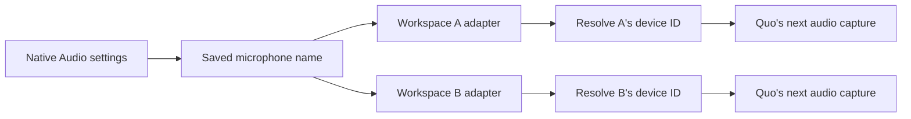

# One microphone across workspaces

**Settings → Audio** selects a microphone for every workspace. System Default follows the Mac's default input at the next capture. Refresh briefly requests microphone access in the selected workspace to reveal device names. Per-workspace status shows whether the chosen device can be resolved in each isolated profile.

Device IDs are scoped to browser origins and profiles. Copying one account's ID to another would be unreliable. Switchboard saves only the human-readable device name. Each profile enumerates its own devices and applies the matching ID as an exact constraint to Quo's next `getUserMedia` audio request. The initial settings handshake completes before a capture proceeds. [The Media Capture specification](https://www.w3.org/TR/mediacapture-streams/) defines the underlying device and capture behavior.

## Behavior

- The choice applies to all connected profiles and persists across restart. Newly added profiles receive it too.
- Existing Quo streams remain intact. Changing the choice during a call applies to its next capture; it does not replace the current WebRTC track.
- Missing or duplicate device names are reported explicitly. A chosen device that cannot be resolved fails rather than silently capturing from another microphone.
- Device changes trigger enumeration again. Each workspace needs its own browser media permission; macOS permission is also required.
- Opening Settings does not capture audio. Refresh briefly captures and stops. Test microphone uses a ten-second local input meter, with no recording, upload, or playback.
- Closing Settings, switching tabs/workspaces, pressing Stop, or reaching the deadline stops local test tracks and closes the analyser. A recognized call or ongoing capture blocks a new test.
- These controls select input only. Speaker output and automatic replacement of an active call's microphone are not implemented.

Only preference labels and validated availability/meter state cross into the main process. Origin-specific device IDs stay inside their workspace. Credentials and browser sessions are unaffected. Quo remains responsible for the actual call media transport.

## Verification boundary

Desktop tests use Chromium's synthetic microphones. They verify different per-profile device IDs, a non-default selection across two profiles, restart persistence, missing-device rejection, capture preservation, and local-test cleanup. A native Mac preview verifies the picker, both workspace statuses, and input meter.

That does not prove physical hardware or Quo's current live calling interface. Before relying on it, test a new real call in every workspace with the selected physical microphone. Verify mute/hold/end through the popover, denied permission, unplug/reconnect, duplicate names, USB and Bluetooth devices, sleep/wake, and network recovery. During an existing call, a preference change must leave its current microphone intact. Use the [full acceptance checklist](testing.md).
