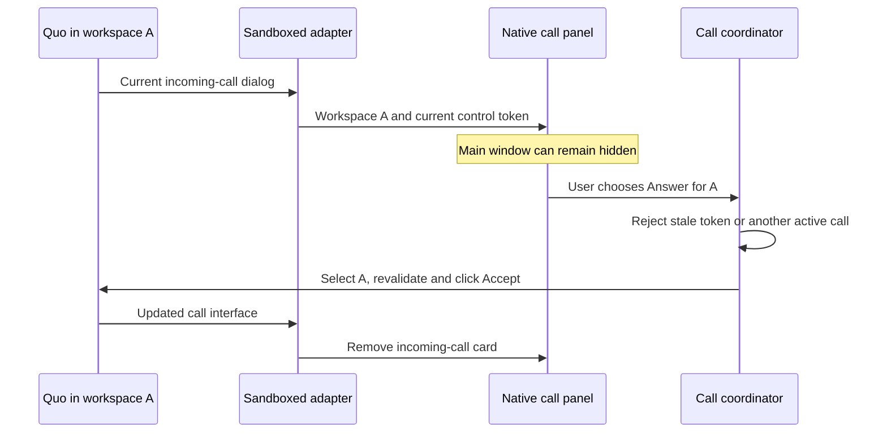

# Desktop call controls

Reviewed October 2, 2026 against macOS 27, Electron 44, and Quo's current public web application and API specification.

## Native call presentation

When Switchboard's main window is active, an incoming call opens an AppKit sheet. It names the workspace and caller and presents compact native Answer and Decline controls. It does not resize Quo or insert a full-width banner. Multiple incoming workspaces stay distinct in a scrolling sheet. Call waiting stays in a modeless panel so it cannot block the active call's controls. [Apple sheets](https://developer.apple.com/documentation/appkit/nswindow/beginsheet(_:completionhandler:)).

When the main window is closed, minimized, or another application is active, floating controls use a nonactivating AppKit `NSPanel`. Its system glass surface, SF Symbols, fonts, and buttons come from AppKit. Appearance follows macOS; the workspace accent identifies the source. The panel does not activate Switchboard merely by appearing. A user may focus its controls. [Apple nonactivating panels](https://developer.apple.com/documentation/appkit/nswindow/stylemask-swift.struct/nonactivatingpanel), [native glass buttons](https://developer.apple.com/documentation/appkit/nsbutton/bezelstyle-swift.enum/glass), [button tint hierarchy](https://developer.apple.com/documentation/appkit/nsbutton/tintprominence).

Answer opens the receiving workspace and invokes its current call control. While the request is pending, the native controls disable repeat actions. The sheet ends before routing the command. AppKit's dismissal completes before Electron destroys the parent window during shutdown. Dismiss or Escape hides an alert without declining its call; the workspace badge and Quo controls remain available. An ended call removes the presentation. Caller privacy applies before native views receive details, and screen lock hides the sheet and panel.

**Settings → General → Floating incoming call controls** selects persistent application panels outside the main window. Desktop notifications must also be enabled for that panel. Turning desktop notifications off still permits the foreground call sheet. A panel does not inherit Notification Center's Focus suppression. Disable floating controls when system-managed call alerts are preferred outside the app.

Switchboard's ordinary notifications already use Apple's UserNotifications through Electron. The call sheet/panel suppresses duplicate system call alerts. With floating controls disabled and Switchboard in the background, native system call alerts provide source-bound actions. The packaged app declares `NSUserNotificationAlertStyle: alert`. **System Settings → Notifications → Switchboard → Persistent** controls system alert duration; Focus and screen-sharing preferences may suppress delivery. macOS owns notification colors, materials, layout, and action presentation. The app does not imitate or restyle Notification Center. [Electron notification API](https://www.electronjs.org/docs/latest/api/notification), [notification actions](https://www.electronjs.org/docs/latest/api/structures/notification-action), [Apple notification settings](https://support.apple.com/en-gb/guide/mac-help/mh40583/mac).

Close Window (⌘W), Minimize (⌘M), Zoom, and Show Switchboard (⌘⇧O) remain available. Closing the main window leaves workspace connections and floating calls alive. Native Settings keeps normal close behavior.

## Compatibility contract

The October web build uses a dialog labeled `Incoming call` and a button labeled `Accept`. Earlier Switchboard versions checked only dialog text; an accessible dialog label alone did not match. The adapter now checks both. `Answer call` and `Accept call` remain supported. Disabled Accept controls still identify ringing, but never expose Answer. Decline is offered only when a unique current Decline/Reject control exists in that dialog.

Quo's ongoing call buttons use `End call`, `Mute`/`Unmute`, `Put call on hold`, and `Take call off hold`. These hold labels are now supported. Labels are matched exactly and scoped to the current call region. Ambiguous controls revoke direct actions. Calls with multiple candidate incoming panels, group joining/listening, untranslated labels, or a changed interface may require opening Quo directly. No generated CSS class or private voice-model method authorizes an action.

Each native command carries a workspace ID and ephemeral DOM-control token. The main process validates both, checks locally observed active calls, selects the source, and sends an IPC request. The source renderer revalidates immediately before clicking and acknowledges the click. A click acknowledgement is not proof that Quo connected the call; Quo owns signaling, audio, permissions, and server state.

Caller details come only from Quo's page Notification payload, are held in memory for the current observed ring, and obey preview privacy. No conversation history is inspected. The notification shim does not intercept service-worker notifications.

## Why no CallKit or webhook Answer?

`CXProvider` and LiveCommunicationKit's `ConversationManager` are unavailable to native AppKit macOS applications, including the macOS 27 SDK. Their Mac support is through Mac Catalyst. Framework files existing in the SDK do not make these types usable from an AppKit app. [CXProvider](https://developer.apple.com/documentation/callkit/cxprovider), [ConversationManager](https://developer.apple.com/documentation/livecommunicationkit/conversationmanager).

Quo's current public specification exposes call records, recordings, summaries, transcripts, voicemail, and webhook registration. It documents no live Answer, hang-up, or media-session endpoint. Webhooks cannot supply that missing call-control transport. [Quo calls](https://www.quo.com/docs/mdx/api-reference/calls/list-calls), [official OpenAPI specification](https://openphone-public-api-prod.s3.us-west-2.amazonaws.com/public/openphone-public-api-v1-prod.json).

## Verification boundary

Fixtures cover calls in hidden source workspaces, simultaneous incoming workspaces, stale tokens, cancellation, disabled and ambiguous controls, shared busy state, privacy, screen lock, and current Quo labels. They do not prove real provider delivery after sleep, notification presentation under every system preference, or real audio connectivity. Those require actual calls with each account, including after an extended idle period. Keep Switchboard running; quitting stops all workspace connections.
