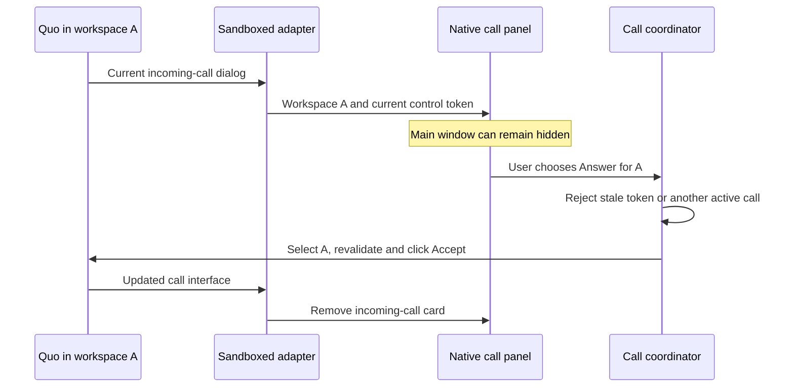

# Desktop call controls

Reviewed October 2, 2026 against macOS 27, Electron 44, and Quo's current public web application and API specification.

## Two native surfaces

Switchboard already uses Apple's UserNotifications through Electron. The packaged app declares `NSUserNotificationAlertStyle: alert`, required for macOS notification buttons. A recognized incoming call stays registered until its control disappears; it has no application timeout. **System Settings → Notifications → Switchboard → Persistent** controls whether its desktop alert stays visible. Focus and screen-sharing preferences can still suppress it. The application does not change those system settings. [Electron notification actions](https://www.electronjs.org/docs/latest/api/structures/notification-action), [Apple notification settings](https://support.apple.com/en-gb/guide/mac-help/mh40583/mac).

The floating call panel is a separate AppKit `NSPanel`. It shows each recognized incoming call and workspace, including when the main window is closed or another workspace is selected. It does not activate Switchboard when it appears. Answer and Decline use the originating workspace's current controls. Answer opens that workspace automatically. Dismiss hides that call's card without declining it. Cancellation or answering elsewhere removes the card when Quo updates its interface. [Apple nonactivating panels](https://developer.apple.com/documentation/appkit/nswindow/stylemask-swift.struct/nonactivatingpanel).

The main window also shows a native incoming-call strip above Quo, regardless of which workspace is selected. It reserves layout space rather than covering Quo's controls. Up to three rows fit before the strip scrolls. Both surfaces share the same source-bound commands and preview privacy. Turning desktop alerts off leaves the in-app controls available. Green Answer and red Decline controls retain their colors while the app is inactive; their white text has at least 4.5:1 contrast. Color accompanies text and SF Symbols, never replaces them.

**Settings → General → Floating incoming call controls** enables the panel. Desktop notifications must also be enabled. Screen lock hides it. Hide caller and message previews also hides its caller text. A panel is application UI: it does not inherit Notification Center's Focus suppression. Disable floating controls if only system-managed alerts are wanted.

The panel does not become the key window. Close Window (⌘W), Minimize (⌘M), Zoom, and Show Switchboard (⌘⇧O) remain main-window commands; native Settings keeps normal close behavior. Closing the main window leaves workspace connections and floating calls alive.

## Compatibility contract

The October web build uses a dialog labeled `Incoming call` and a button labeled `Accept`. Earlier Switchboard versions checked only dialog text; an accessible dialog label alone did not match. The adapter now checks both. `Answer call` and `Accept call` remain supported. Disabled Accept controls still identify ringing, but never expose Answer. Decline is offered only when a unique current Decline/Reject control exists in that dialog.

Quo's ongoing call buttons use `End call`, `Mute`/`Unmute`, `Put call on hold`, and `Take call off hold`. These hold labels are now supported. Labels are matched exactly and scoped to the current call region. Ambiguous controls revoke direct actions. Calls with multiple candidate incoming panels, group joining/listening, untranslated labels, or a changed interface may require opening Quo directly. No generated CSS class or private voice-model method authorizes an action.

Each native command carries a workspace ID and ephemeral DOM-control token. The main process validates both, checks locally observed active calls, selects the source, and sends an IPC request. The source renderer revalidates immediately before clicking and acknowledges the click. A click acknowledgement is not proof that Quo connected the call; Quo owns signaling, audio, permissions, and server state.

Caller details come only from Quo's page Notification payload, are held in memory for the current observed ring, and obey preview privacy. No conversation history is inspected. The notification shim does not intercept service-worker notifications.

## Why no CallKit or webhook Answer?

`CXProvider` and LiveCommunicationKit's `ConversationManager` are unavailable to native AppKit macOS applications, including the macOS 27 SDK. Their Mac support is through Mac Catalyst. Framework files existing in the SDK do not make these types usable from an AppKit app. [CXProvider](https://developer.apple.com/documentation/callkit/cxprovider), [ConversationManager](https://developer.apple.com/documentation/livecommunicationkit/conversationmanager).

Quo's current public specification exposes call records, recordings, summaries, transcripts, voicemail, and webhook registration. It documents no live Answer, hang-up, or media-session endpoint. Webhooks cannot supply that missing call-control transport. [Quo calls](https://www.quo.com/docs/mdx/api-reference/calls/list-calls), [official OpenAPI specification](https://openphone-public-api-prod.s3.us-west-2.amazonaws.com/public/openphone-public-api-v1-prod.json).

## Verification boundary

Fixtures cover calls in hidden source workspaces, simultaneous incoming workspaces, stale tokens, cancellation, disabled and ambiguous controls, shared busy state, privacy, screen lock, and current Quo labels. They do not prove real provider delivery after sleep, notification presentation under every system preference, or real audio connectivity. Those require actual calls with each account, including after an extended idle period. Keep Switchboard running; quitting stops all workspace connections.
