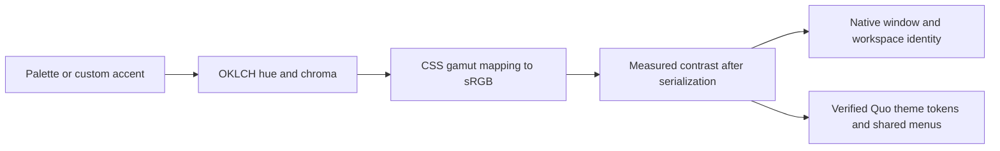

# Workspace themes

Open **Workspace → Workspace theme…**, the workspace’s native context menu, or its menu-bar menu. Choose Quo, Mac, Ocean, Pine, Iris, Ember, Graphite, or a custom accent. Appearance can follow macOS, stay light, or stay dark. **Apply** saves; **Cancel** and Escape restore the previous palette. A notification that switches accounts also cancels an unfinished preview.

Quo with Automatic restores Quo’s original colors and appearance behavior. Other palettes follow the chosen workspace mode. Mac uses the current macOS accent. Custom colors are seeds: the resulting controls are adjusted for readability rather than copying an unsafe color verbatim.

## Color model

Color.js 0.7.1 supplies conversion, CSS Color 4 gamut mapping, and WCAG contrast measurement. Primary/secondary/tertiary text and foreground accents meet at least 4.5:1 across generated surfaces, hover, and selection. Increase Contrast raises the target to 7:1. Solid controls retain a separately checked white foreground across normal, hover, and pressed fills. Borders meet 3:1 against primary surfaces, or 4.5:1 with increased contrast. This verifies our generated roles; it is not a certification of every remote Quo screen.

Native controls keep the Mac’s semantic styling. The active workspace selects native window appearance and a restrained glass tint. Reduce Motion disables ringing animation and suppresses page transitions under an applied theme. Reduce Transparency remains handled by AppKit’s native material.

## Coverage and compatibility

The current adapter covers Quo’s shared neutral/accent/background/overlay roles, dialogs and body-level portal menus, plus BlockNote/Mantine editor/menu tokens and Plyr audio-control tokens. Locked call surfaces stay dark, while warning/success families, brand colors, external logos, avatars, images, and content formatting retain their identities.

The adapter reads the public same-origin stylesheet through CSSOM. It discovers the generated token prefix, verifies all 88 ordered values against reviewed fingerprints, and maps semantic roles. Generated class names are not the primary contract. Audited neutral exceptions remain deliberately small. Presentation never changes React state, call controls, routing, authentication storage, or Quo’s own saved preferences.

If the token contract changes, the adapter removes its color overrides and the picker reports that original colors were preserved. The chosen theme remains saved for a compatible future adapter. Login forms and authentication origins remain untouched. Third-party frames and image contents are not recolored. Quo can change markup or add styling outside this contract; therefore complete future compatibility cannot be guaranteed.

To update compatibility, review Quo’s public theme definition and stylesheet, establish each role, update the reference values/fingerprints, and rerun contrast, portal, editor, authentication, cancellation, and profile-restoration tests. A matching token count alone is insufficient. Do not approve a new fingerprint just to suppress the warning.

Design references: [Apple color](https://developer.apple.com/design/Human-Interface-Guidelines/color), [Apple Dark Mode](https://developer.apple.com/design/human-interface-guidelines/dark-mode), [Slack themes](https://slack.com/help/articles/205166337-Change-your-Slack-theme), [Color.js gamut mapping](https://colorjs.io/docs/gamut-mapping), [WCAG text contrast](https://www.w3.org/WAI/WCAG21/Understanding/contrast-minimum).
