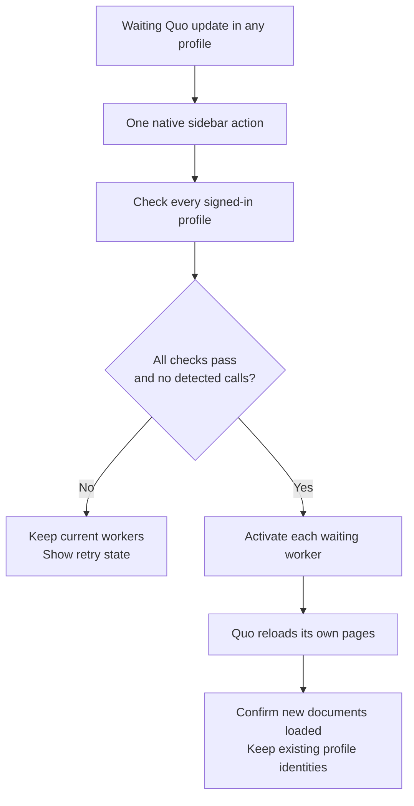

# Shared Quo updates

Quo stores its web app in each workspace's browser profile. That keeps sign-ins separate, but also gives each profile its own service worker and pending update.

When an installed update is waiting, **Update all workspaces** appears at the bottom-left of Switchboard. The compact rail shows the same action as an SF Symbol. One click checks every signed-in workspace and activates its waiting update. **Workspace → Update all workspaces** (⌘⇧U) also checks for updates when the sidebar action is hidden.

## Implementation

The sandboxed adapter observes the root, same-origin `/sw.js` registration through standard service-worker events and a ten-second fallback poll. A waiting worker receives a temporary identity so a stale action cannot activate a replacement worker.

The main process checks every ready Quo profile using `ServiceWorkerRegistration.update()`. It activates none if any check fails. Recognized incoming or active calls, microphone captures/tests, and loading/offline/failed workspaces block the shared action. The coordinator rechecks after downloads; each page checks its current call controls again immediately before activation. Downloads leave the command queue free for Answer, End, and switching.

Activation sends `{ type: 'SKIP_WAITING' }`, matching Quo's public Workbox implementation inspected on October 2, 2026. Quo's own `controllerchange` handler reloads the page. Switchboard waits for a new ready document with no waiting worker; sending the message alone is not reported as completion. It never unregisters workers, clears caches or cookies, replaces profile IDs, or handles credentials. Authentication pages are excluded.

## Boundaries

- This updates **Quo's web app**. Installing a new Switchboard DMG remains a separate app update.
- Activation across independent profiles is not a transaction. A late failure can leave one updated and another pending; Switchboard reports an incomplete update and permits a retry.
- Reloading follows Quo's own update behavior. Save unfinished work first. A call this adapter cannot recognize cannot be protected by its call guard.
- Quo can change its worker path or message contract. Unknown registrations fail the shared check; the adapter does not guess or click unrelated controls. Quo's own automatic update behavior remains in place.

The desktop suite uses real Chromium workers: staged updates in two profiles, cookie/local-storage preservation, a call answered during downloading, a failed check, and recovery on retry. Fixtures establish the coordinator's behavior, not future Quo compatibility. See [verification](testing.md).

References: [Quo web app](https://my.quo.com/), [W3C service-worker update API](https://www.w3.org/TR/service-workers/#service-worker-registration-update) (September 17, 2026 Candidate Recommendation Draft).
