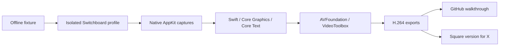

# Product walkthrough

The 34-second walkthrough uses fictional workspaces, people, messages, phone numbers, and unread counts. Studio, Workshop, and Field Team are demo accounts. All phone numbers are within the reserved North American `555-0100`–`555-0199` range.

The Mac controls are captured from Switchboard itself. The Quo conversation area is an offline fixture. The edited call sequence exercises Switchboard's production account routing against a simulated incoming call; it neither places a call nor connects live audio. The video labels this throughout the call scene. It is a product walkthrough, not evidence of provider-side call delivery or long-term sign-in retention.

| Time | Demonstration |
| --- | --- |
| 0–3 seconds | One app for multiple Quo workspaces |
| 3–9 seconds | Switch Studio → Workshop → Field Team → Studio |
| 9–17 seconds | A simulated call arrives in Workshop; Answer opens Workshop |
| 17–25 seconds | Native theme picker, Iris dark, and independent light appearance in Studio |
| 25–30 seconds | Native menu-bar activity and observed demo unread counts |
| 30–34 seconds | Project name, MIT license, author, and repository |

## How the video is made



The capture script boots the normal application through the desktop-test bootstrap. Every HTTPS request from the isolated workspace sessions is served from the local fixture. It creates a fresh temporary profile and removes that profile on exit. It never opens the installed app's profiles.

Opaque windows are captured by their own window IDs. For native glass, a ScreenCaptureKit inclusion filter permits only the demo process's panel and its plain background window. Other apps, the desktop, Dock, and menu bar are excluded. Images are reviewed before publication. No live screenshots, authentication data, caller records, or device audio belong in this workflow.

The renderer uses macOS system typography, cubic easing, native image drawing, and the current asynchronous AVFoundation pixel-buffer receiver. Frames are deterministic at 30 fps. Captions carry the story without sound; the exports contain no audio track. Both layouts are authored separately, so the square version retains its captions and call controls instead of cropping the widescreen video.

## Reproduce

Requires macOS 26 or later, Xcode 27, the project dependencies, FFmpeg, and Python 3 with Pillow. The video tools have no cloud-rendering dependency. Build the application first:

```sh
npm ci
npm run build
bash tools/walkthrough/export.sh
```

macOS must allow screen capture for the process running the script. Existing master exports are not overwritten. Move previous files aside before rendering again.

The compact widescreen and square MP4s, poster, and short animated preview live in `docs/media/`. Captures, render binaries, and larger masters stay in ignored `release/walkthrough/`. The full editing source lives in `tools/walkthrough/` under the project's MIT license. Apple system fonts are rendered locally; font files are not redistributed.

GitHub's [file attachment guidance](https://docs.github.com/en/get-started/writing-on-github/working-with-advanced-formatting/attaching-files) recommends H.264 and sets a 10 MB video limit on free plans. The committed MP4 stays below that limit. Keep the repository private until its publication review is approved. The [X video guide](https://help.x.com/en/using-x/x-videos) covers uploading the square export; this workflow does not publish a post.
